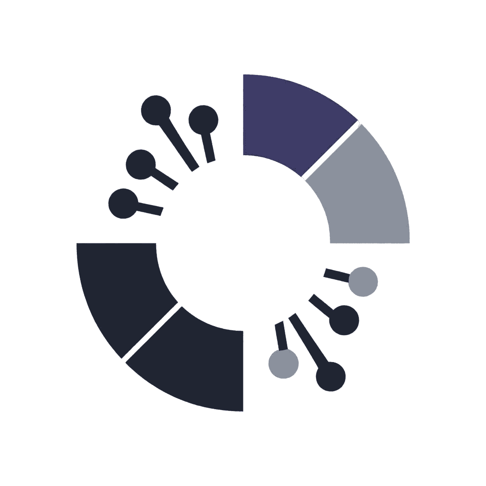
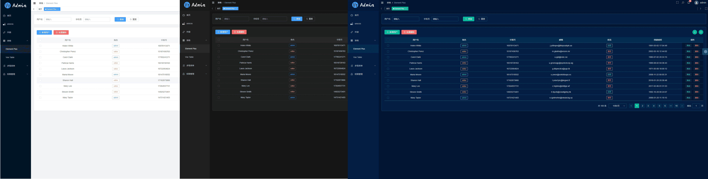

<div align="center">
  
  <h1>MTQ UiX Vue - AI Friendly</h1>
</div>

MTQ UiX Vue is an AI-friendly admin dashboard template built on mainstream technologies such as Vue3, Vite, and TypeScript, organized with a strict Feature-Sliced Design (FSD) architecture.

## Architecture

The codebase follows Feature-Sliced Design. The `src` directory is split into six layers, ordered top → bottom:

| Layer | Responsibility | Example |
|---|---|---|
| `app` | Entry point, router, plugins, providers, layout shell, global styles | `main.ts`, `layouts`, `router`, `providers/pinia` |
| `pages` | Full pages: documentation, demos | `login`, `dashboard`, `demo` |
| `widgets` | Composite blocks composed of entities/features | `navigation`, `tag-bar`, `settings-panel`, `app-main` |
| `features` | User scenarios / business logic | `theme`, `access-control`, `search`, `notifications` |
| `entities` | Domain state (stores) and data entities | `user`, `settings`, `app-ui`, `permission`, `tags-view` |
| `shared` | Primitives: API transport, utils, tokens, types, neutral UI, assets | `api`, `lib`, `constants`, `types`, `ui`, `styles/tokens` |

### Dependency rules

- A layer may import **only strictly lower layers** (e.g. `widgets → features → entities → shared`).
- No upward imports, no sibling imports within a layer.
- `shared` imports only external packages — it contains no business logic.
- `shared/api` is transport + generated clients only; endpoints are generated by Orval from `specs/` into `shared/api/generated/`.
- Path aliases are used everywhere (`@/shared`, `@/entities`, `@/features`, `@/widgets`, `@/pages`, `@/app`); no `../../../` chains.
- Boundaries are enforced with ESLint `no-restricted-imports` and Steiger (`npx steiger ./src`).

### Directory structure

```sh
src
├─ app
│  ├─ App.vue               # root component
│  ├─ main.ts               # entry point (wires session + unauthorized handlers)
│  ├─ layouts               # layout shell and modes (composes widgets)
│  ├─ lib                   # document title
│  ├─ plugins               # global components, custom directives
│  ├─ providers             # pinia instance
│  ├─ router                # routes, guards, helpers
│  └─ styles                # global styles and themes
├─ pages
│  ├─ dashboard             # dashboard (role-based)
│  ├─ demo                  # demos (ui-primitives, composables, permission)
│  ├─ error                 # 403 / 404
│  ├─ login                 # login
│  └─ redirect              # redirect helper
├─ widgets
│  ├─ navigation            # sidebar, navbar, breadcrumb, logo
│  ├─ tag-bar               # tab navigation
│  ├─ settings-panel        # settings drawer + layout-mode switcher
│  └─ app-main              # main content area + footer
├─ features
│  ├─ theme                 # theme switcher
│  ├─ color-mode            # gray / color-weakness mode
│  ├─ layout-mode           # left / top / hybrid layout
│  ├─ access-control        # permission check + v-permission directive
│  ├─ notifications         # notification panel + popups
│  └─ search                # global menu search
├─ entities
│  ├─ user                  # session store + current-user API
│  ├─ settings              # layout settings store
│  ├─ app-ui                # device / sidebar state store
│  ├─ permission            # accessible routes store
│  └─ tags-view             # tags bar store
└─ shared
   ├─ api                   # axios transport + generated clients (Orval)
   ├─ lib                   # utils and pure composables
   ├─ constants             # enums, cache keys, route paths
   ├─ types                 # data contracts and ambient declarations
   ├─ ui                    # base UI primitives (button, badge, tabs, form, …)
   ├─ assets                # icons and images
   └─ styles
      └─ tokens             # primitive design tokens (palette, spacing, radius)
```

The layout shell lives in `app/layouts`; theme schemes (semantic tokens) live in `app/styles/themes/`, switched via the `data-theme` attribute.

### API specs and codegen

OpenAPI specs live in `specs/` (one file per backend service). Orval generates clients into `src/shared/api/generated/` — never edit them by hand.

```bash
# Regenerate API clients from specs/
pnpm codegen:api
```

## Documentation

- [Architecture](ARCHITECTURE.md) — FSD layers, dependency rules, slice structure, API specs, style scheme.
- [Development](DEVELOPMENT.md) — environment setup, commands, workflows, conventions, and how-to-use for every base UI primitive.

## Requirements

- `node` 20.19+ or 22.12+
- `pnpm` 10+

## Getting Started

```bash
# Clone the project
git clone git@github.com:MonadTeq/mtq-uix-vue-template.git

# Enter the project directory
cd mtq-uix-vue-template

# Install dependencies
pnpm i

# Start the development server
pnpm dev
```

## Development

```bash
# Code linting and formatting
pnpm lint

# Run unit tests (Vitest)
pnpm test

# Type checking (vue-tsc)
pnpm exec vue-tsc --noEmit

# Architecture boundary check (Feature-Sliced Design)
npx steiger ./src

# Regenerate API clients from OpenAPI specs
pnpm codegen:api
```

## Build

```bash
# Build for the staging environment
pnpm build:staging

# Build for the production environment (runs vue-tsc type checking first)
pnpm build

# Preview the production build locally (run `pnpm build` first)
pnpm preview
```

## Commit Guidelines

`feat` New feature

`fix` Bug fix

`perf` Performance improvement

`refactor` Code refactoring

`docs` Documentation and comments

`types` Type-related changes

`test` Unit tests related

`ci` Continuous integration, workflows

`revert` Revert changes

`chore` Chores (update dependencies, modify configurations, etc)

## Features

**Simplified structure**: No complex encapsulation, no complicated type gymnastics, just enough to meet the needs

**Detailed comments**: Every configuration item comes with as detailed comments as possible

**Latest dependencies**: Keeps all third-party dependencies up to date

**Consistency**: Unified code style, naming conventions, and comment style

## Built-in Features

**Base UI Library**: A set of headless, themeable primitives (button, badge, tabs, modal, form controls, and more) in `shared/ui`, styled with semantic tokens — see [DEVELOPMENT.md](DEVELOPMENT.md) for usage.

**User Management**: Login, logout demonstration

**Permission Management**: Page-level permissions (dynamic routing controlled by backend APIs), button-level permissions (permission directives and functions), and route guards

**Multiple Environments**: Development, staging, and production environments

**Multiple Themes**: Normal, dark, and deep blue themes

**Multiple Layouts**: Left-side, top, and hybrid layouts

**Homepage**: Different dashboard pages for different users

**Error Pages**: 403, 404

**Mobile Compatibility**: Layouts compatible with mobile screen resolutions

**Others**: SVG sprite sheet, dynamic sidebar, dynamic breadcrumbs, tab navigation, content zoom and fullscreen, composable functions

## Tech Stack

**Vue3**: Vue3 + script setup with the latest Vue3 Composition API

**Pinia**: The legendary Vuex5

**Vite**: Really fast

**Vue Router**: The routing system

**TypeScript**: A superset of JavaScript

**pnpm**: A faster, disk-space-saving package manager

**Scss**: CSS preprocessing

**CSS Variables**: Primarily controls layout and color in the project

**ESLint**: Code linting and formatting

**Axios**: Sends network requests

## Project Preview Image



## License

[MIT](./LICENSE) License
